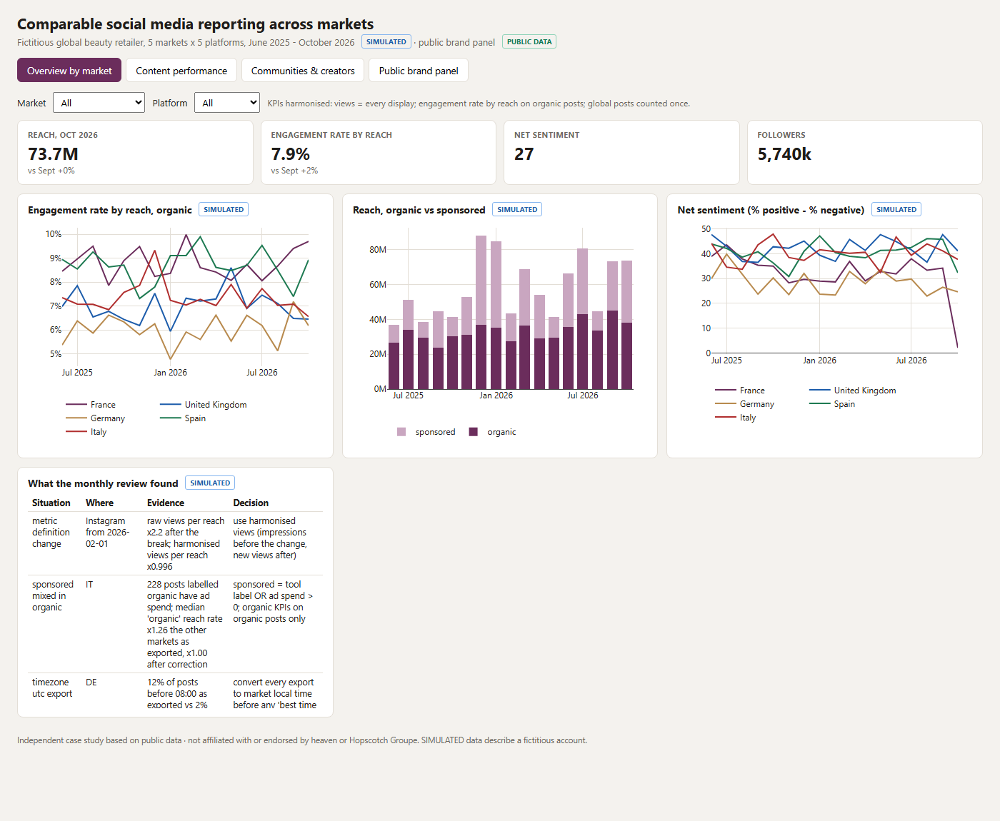

# heaven: comparable social media reporting across markets, from metrics to recommendations

Public data on Hopscotch Groupe and on beauty brands' public signals (Wikipedia interest, Eurostat, Mastodon, Bluesky),
plus a simulated, calibrated multi-market beauty retail account, turned into a harmonised KPI framework, a monthly client
report, an influencer community analysis and a reusable methodology.

*Independent case study based on public data · not affiliated with or endorsed by heaven or Hopscotch Groupe.*
Data are tagged **PUBLIC DATA** or **SIMULATED** everywhere. The simulated account is a fictitious "global beauty
retailer": it does not describe any real brand, heaven, Hopscotch Groupe or any of their clients.

## Deliverables

- **8-page case study (PDF)**: [docs/heaven_social_media_reporting_case_study.pdf](docs/heaven_social_media_reporting_case_study.pdf)
- **Interactive dashboard**: [albt-france.github.io/heaven-social-media-reporting-case-study/dashboard/social_dashboard.html](https://albt-france.github.io/heaven-social-media-reporting-case-study/dashboard/social_dashboard.html)



## Key results

1. **One KPI must mean the same thing everywhere, and four corrections come first** (SIMULATED). Without them, group reach is
   overstated by 11.1% (global posts counted in every market), Instagram "views" jump x2.2 when the metric changes
   definition, Italy's "organic" reach looks 1.26 times the other markets (boosted posts exported as organic), and Germany's
   best hour to post reads 18:00 instead of 20:00 (export in UTC). The definition change is modelled on a real one: Meta's
   `views` metric replacing `impressions` and `plays` for Instagram insights in 2025.
2. **8 of 8 hidden situations found, and the false alarm is not raised** (SIMULATED). Spain's engagement per follower fell
   19% after a giveaway added 37% followers, while engagement per reach rose 4%: a denominator effect, not a content problem.
   France's net sentiment fell to 2 from 33 usually, with stock or availability in 76% of negative comments.
3. **Formats and creators are a market-by-market decision** (SIMULATED). On Instagram, short video beats carousel in France
   (x1.38) and Spain (x1.19); in Germany the carousel wins (short video x0.57). The mention graph splits 500 creators into
   9 communities, each anchored in a single market; one creator (+163% followers in a week, very low engagement) is excluded.
4. **Public context differs by market** (PUBLIC DATA). Social-network use ranges from 56.4% (Italy) to 70.8% (France) in
   2025 (Eurostat); the brand with the most Wikipedia interest is not the same in every language, and seasonal interest
   (sunscreen) moves 2.3x to 8.4x across the year depending on the language.

## Methods

- **Collection** (`src/fetch_public.py`, optional `src/fetch_youtube.py`): official APIs and public pages only, `robots.txt`
  respected, one request every 1.5 s or more, neutral User-Agent. No scraping of Instagram, TikTok, Facebook or X.
  Published files hold aggregates only: no post text, no personal account.
- **Simulation** (`src/simulate.py`, seed 42): 5 markets x 5 platforms, June 2025 - October 2026, 6,744 posts, ads spend,
  daily followers, about 19,000 synthetic comments in 5 languages, 500 anonymous creators and their mentions. Calibration
  and the 8 hidden situations: [data/ASSUMPTIONS.md](data/ASSUMPTIONS.md).
- **SQL** (`sql/`, DuckDB, CTEs and window functions): `01_harmonise` (metric dictionary, definition change, time zones,
  sponsored flag, deduplication), `02_monthly_kpis` (market x platform x format, month-on-month, 3-month average),
  `03_anomalies` (robust z-score against the 6 previous months + data-quality checks), `04_creators` (tiers, growth,
  authenticity score).
- **Decisions** (`src/detect.py`): each flag is classified as a content issue, a data issue or a false signal.
- **Sentiment and themes** (`src/lexicon.py`): rule-based lexicon in French, English, German, Spanish and Italian, no LLM,
  so everything re-runs without a key. 90% agreement on the simulated comments (lowest: German, 79%); optimistic for real
  comments, which need a hand-labelled sample.
- **Communities** (`src/analyse.py`, `networkx`): mention graph, Louvain communities, PageRank, betweenness.
- **Report checks** (`src/fact_check.py`, `pytest`): every number in the PowerPoint is traced to the fact sheet
  (`data/processed/facts.json`), with the right market and subject; the tests include deliberately wrong numbers that must be caught.

AI-assisted workflow: I used Claude, mainly to write scripts faster. I drove the project: I defined the questions, chose and validated the data sources, made the analytical decisions and checked every result.

## How to re-run

```bash
python -m venv .venv && .venv/Scripts/activate      # Windows; source .venv/bin/activate elsewhere
pip install -r requirements.txt
python src/fetch_youtube.py        # optional: needs YOUTUBE_API_KEY in .env (see .env.example); skipped cleanly without it
python src/fetch_public.py         # optional: refreshes data/public/ (the committed snapshot is used otherwise)
python src/simulate.py             # data/simulated/
python src/run_sql.py              # data/processed/ (SQL, detection, communities, fact sheet)
python src/build_report_pptx.py    # reports/ (PowerPoint, plus PDF if LibreOffice is installed)
pytest                             # number checker, detection, harmonisation, privacy
python src/build_notebook.py       # executes notebooks/social_analysis.ipynb
python src/build_dashboard.py      # dashboard/social_dashboard.html
python src/build_pdf.py            # docs/ (PDF via headless Microsoft Edge)
```

No key is needed for any step except the optional YouTube collector.

## Sources and licences

Full list with dates and links: [data/SOURCES.md](data/SOURCES.md). Hopscotch Groupe investor relations and heaven.paris
(facts quoted as stated by the companies); the job posting (as stated); Eurostat `isoc_ci_ac_i` (CC BY 4.0); Wikimedia
Pageviews API (CC0); mastodon.social and Bluesky public APIs (aggregates only); Meta for Developers and TikTok API for
Business documentation (cited). Collected on 17 November 2026.

## Limits

- No access to real Instagram, TikTok, Facebook or X account data: the reporting mission runs on a simulated account.
- The YouTube panel was not collected in this version (no API key); the collector is ready.
- Mastodon volumes are small and not representative of beauty consumers; the English Wikipedia is global, not a UK measure;
  Eurostat stops covering the UK after 2020.
- No professional social-listening tool was used; the pipeline is built to read such exports.
- Sentiment levels are not compared across languages; only changes within a market are read.
